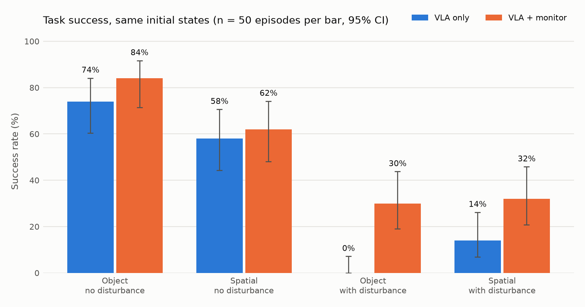

# しくじりに気づくロボット — VLA に後付けする失敗検知・回復レイヤ

Physical AI 応用1 最終課題。

VLA（視覚・言語・行動モデル）は自分の失敗に気づかない。空振りしたまま空の手で運び続けたり、
同じ失敗を繰り返したりする。本作品では、**どの VLA にも外付けできる監視層**を作り、
失敗に気づいて立て直すことで成功率がどれだけ戻るかを、シミュレータで定量的に示す。

- ロボット / 環境: Franka Panda / [LIBERO](https://github.com/Lifelong-Robot-Learning/LIBERO)（MuJoCo、lerobot 同梱版）
- 方策: 公開 VLA [`lerobot/smolvla_libero`](https://huggingface.co/lerobot/smolvla_libero)（Apache-2.0、推論のみ。追加学習なし）
- 実行: Google Colab（T4）

## 仕組み

```
LIBERO ──観測──▶ MonitoredController ──行動──▶ LIBERO
                  │  L1 把持失敗: 閉じ指令を出して指が止まったとき、開き幅が閾値未満 → 空振り / 落下
                  │  L2 停滞・迷走: 直近 60 step の手先の移動範囲が小さい / グリッパの開閉を繰り返す
                  ▼
                回復: 開く → 8cm 上がる → 水平に 1〜2.5cm ランダムにずらす → VLA の行動キューを捨てて再開
                      2 回やり直しても駄目なら HELP（止まって助けを求める）
```

- 監視層が見るのは**ロボット自身が観測できる量だけ**（手先位置・指の位置・直前の行動）。
  シミュレータの正解（物体の位置、指と物体の接触）は**採点と妨害の演出にだけ**使う
- 監視層は方策の外側にあるので、VLA を差し替えても同じコードで動く
- ずらしてから再開する理由: 掴めるかどうかは mm 単位の状態差で決まることが多く、
  同じ状態に戻すと VLA は同じ行動を出して同じ失敗を繰り返す

### 妨害テスト
ロボットが物を持ち上げた瞬間に、シミュレータで物を元の場所へ戻す（人が手から取り上げて置き直すのを模す）。
素の VLA は空の手で運び続け、監視層ありでは落下に気づいて取り直す。

## 結果

LIBERO-Spatial / LIBERO-Object 各 10 タスク × 初期状態 5〜9 番。素の VLA と監視ありを**同じ初期状態・同じ乱数**で走らせた（各棒 50 エピソード、計 400）。



| スイート | 妨害 | 素の VLA | 監視あり |
|---|---|---|---|
| Spatial | なし | 29/50 = 58% | 31/50 = 62% |
| Spatial | あり | 7/50 = 14% | 16/50 = 32% |
| Object | なし | 37/50 = 74% | 42/50 = 84% |
| Object | あり | 0/50 = 0% | 15/50 = 30% |

- **対で比べると救済 33・悪化 2**（McNemar 正確検定 p = 3.7×10⁻⁸）。妨害なしだけでも 66% → 73%（p = 0.039）、妨害ありは 7% → 31%（p = 8×10⁻⁷）
- **検知の的中率 99.9%**: 検知した空振り・落下 713 件のうち 712 件で、その瞬間に本当に何も掴んでいなかった
  （正解はシミュレータの指と物体の接触。監視層自身は見ていない）
- 監視層が一度も介入しなかった 72 対で結果が食い違ったのは 2 対（約 3%）。走行ごとのぶれは小さい
- HELP（2 回やり直しても駄目で停止）は妨害ありで 53 件。うち 52 件は素の VLA でも失敗した場面で、
  空振りを続ける代わりに早めに止まって助けを求めた

閾値（指の開き幅 0.003 m）は、評価とは別の初期状態 0〜2 番の素の VLA の走行（60 エピソード）で較正した。

## 構成

```
monitor/            監視層（シミュレータに依存しない）
  detectors.py        L1 把持失敗 / L2 停滞・迷走
  recovery.py         退避 → ずらす
  wrapper.py          MonitoredController（方策の外側に付ける）
runner/             LIBERO での実験
  libero_setup.py     LIBERO の設定ファイルを先に書き、初回 import 時の対話を飛ばす
  policy.py           公開 VLA の読み込み（前処理は lerobot-eval と同じ経路）
  sim_tools.py        正解判定と妨害（評価専用）
  run_eval.py         条件をそろえた比較実験。中断しても再開できる
  analyze.py          成功率・検知の精度・閾値の較正
  overlay.py          動画用のフレーム合成
notebooks/
  run_colab.ipynb     Colab での実行手順（build_notebook.py で生成）
tests/                監視層の単体テスト
docs/submission/      提出動画のスライドと説明資料の元（HTML）
tools/
  colab_driver.py     ターミナルから Colab で評価を回す
  build_submission.py 提出動画（MP4）と説明資料（PDF）を作る
```

## 再現手順

### Colab（T4）をターミナルから使う（[google-colab-cli](https://github.com/googlecolab/google-colab-cli)）

```bash
python tools/colab_driver.py setup     # T4 セッション作成 → コード転送 → 専用 venv の構築
python tools/colab_driver.py run main_spatial --suite libero_spatial --tasks 0-9 --episodes 5 --init-offset 5 \
    --conditions base,monitor --disturb off,on
python tools/colab_driver.py stop      # 必ず止める
```

タスクごとに結果を `outputs/colab/<名前>/` へ回収するので、VM が落ちても同じコマンドで続きから再開できる。
ブラウザの Colab で回す場合は `notebooks/run_colab.ipynb` を上から実行する。

### ローカル（Linux、CPU でも動くが遅い）

```bash
uv venv -p 3.12 .venv && uv pip install --python .venv -r requirements.txt
.venv/bin/python -m pytest tests
.venv/bin/python -m runner.run_eval --suite libero_spatial --tasks 0 --episodes 1 --conditions base,monitor --out outputs/smoke --video all
.venv/bin/python -m runner.analyze outputs/smoke
```

### 提出物（動画・説明資料）を作る

デモの撮影（`outputs/colab/demo_*/videos/`）を回収したあと、WSL から実行する。HTML の描画と PDF への印刷に Windows 側の Edge を使う。

```bash
.venv/bin/python tools/build_submission.py --account <omnicampusアカウント名>
```

`outputs/submission/` に動画（1920x1080、約 2 分 16 秒、等倍速）と説明資料の PDF ができる。

## 使用した公開物とライセンス

| 名前 | 用途 | ライセンス |
|---|---|---|
| lerobot 0.6.1 | 方策の読み込み・LIBERO 環境 | Apache-2.0 |
| lerobot/smolvla_libero | VLA（推論のみ） | Apache-2.0 |
| LIBERO（hf-libero 0.1.4） | シミュレーション環境 | MIT |
| lerobot/libero-assets | LIBERO の物体・テクスチャ（初回に自動取得） | データセットカードに記載なし（LIBERO 付属アセット） |
