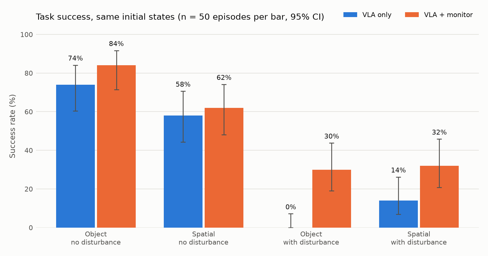

# しくじりに気づくロボット — VLA に後付けする失敗検知・回復レイヤ

Physical AI 応用1 最終課題 説明資料

動画: （YouTube の URL）　コード: （GitHub の URL）

## 1. 概要と目的

VLA（視覚・言語・行動モデル）は、カメラ画像と言語指示から直接ロボットの行動を出す。
しかし、自分の失敗に気づく仕組みを持たない。物を掴み損ねても空の手のまま運び続け、
同じ状態に戻れば同じ失敗を繰り返す。

本課題では、**どの VLA にも外付けできる「気づいて立て直す」監視層**を作った。
公開 VLA（SmolVLA）を LIBERO のシミュレーションで動かし、監視層あり・なしを同じ初期状態で比べる。
これにより、成功率がどれだけ戻るかを定量的に示す。

## 2. システム構成

（図: LIBERO → 監視層 → 行動。L1 / L2 / 回復 / HELP）

| 部品 | 内容 |
|---|---|
| 方策 | `lerobot/smolvla_libero`（公開重み、推論のみ） |
| L1 把持失敗検知 | 閉じ指令を出し続けて指が止まったとき、両指の開き幅が閾値未満なら「何も挟んでいない」。持っていた状態から閾値未満になったら「落とした」 |
| L2 停滞・迷走検知 | 直近 60 step（3 秒）の手先の移動範囲が 8mm 未満、またはグリッパの開閉が 6 回以上 |
| 回復 | 開く → 8cm 上がる → 水平に 1〜2.5cm ランダムにずらす → VLA の行動キューを捨てて再開 |
| HELP | 2 回やり直しても失敗したら止まる（安全にあきらめる） |

監視層が使うのはロボット自身が観測できる量だけである。シミュレータの正解は採点と妨害の演出にだけ使い、
実機にもそのまま持っていける設計にした。

## 3. 工夫した点

1. **方策の外側に付ける設計。** VLA の中身に触れないので、モデルを差し替えても同じコードで動く
2. **「ずらしてから」やり直す。** 同じ状態から再開すると VLA は同じ行動を出す。状態を少し変えて再試行させる
3. **影のモードで検知の精度を測る。** 素の VLA の走行でも検知器だけを動かし、シミュレータの正解（指と物体の接触）と
   突き合わせて適合率・再現率を出した。閾値は較正用の初期状態で決め、評価は別の初期状態で行った
4. **妨害テスト。** ロボットが物を持ち上げた瞬間に、シミュレータで物を元の場所へ戻す（人が取り上げるのを模す）
5. **安全にあきらめる。** 何度やっても駄目なら止まって助けを求める。現場では「無限に再試行しない」ことも重要

サンプル（推論のみのデモ）からの発展点: 開ループの実行に、失敗の検知と回復の閉ループを加え、定量評価まで行った。

## 4. 実験

- 環境: LIBERO-Spatial / LIBERO-Object 各 10 タスク
- 較正: 初期状態 0〜2 番（素の VLA のみ）
- 評価: 初期状態 5〜9 番 × {監視なし, 監視あり} × {妨害なし, 妨害あり}
- 指標: 成功率（95% 信頼区間）、同じ初期状態の対での救済数・悪化数、検知の適合率・再現率、平均 step 数

## 5. 結果

| スイート | 妨害 | 素の VLA | 監視あり |
|---|---|---|---|
| Spatial | なし | 29/50 = 58% | 31/50 = 62% |
| Spatial | あり | 7/50 = 14% | 16/50 = 32% |
| Object | なし | 37/50 = 74% | 42/50 = 84% |
| Object | あり | 0/50 = 0% | 15/50 = 30% |

| 指標 | 値 |
|---|---|
| 同じ初期状態の対での救済 / 悪化 | 33 / 2（McNemar 正確検定 p = 3.7×10⁻⁸） |
| 妨害なしのみ | 66% → 73%（救済 8 / 悪化 1、p = 0.039） |
| 妨害ありのみ | 7% → 31%（救済 25 / 悪化 1、p = 8×10⁻⁷） |
| 検知の的中率（検知した瞬間に本当に空だったか） | 712 / 713 = 99.9% |
| 「閉じて止まった」時点の判定（閾値 0.003 m） | 適合率 100%、再現率 86%（約 2 万 step） |
| 介入しなかった対での結果の食い違い（走行ごとのぶれ） | 2 / 72 = 3% |

較正（初期状態 0〜2 番、素の VLA 60 エピソード）では、何も挟まず閉じたときの開き幅は中央値 0.0015 m、
物を掴んでいるときの最小値は 0.0037 m だった。閾値 0.004 m では適合率が 84% に落ちるため、0.003 m を採用した。

## 6. 考察・限界

- **素の VLA は自分でやり直すが、同じ失敗を繰り返す。** 素の VLA の失敗例でも、検知器（影のモード）は空振りを何度も記録していた。
  VLA は掴み直しを試みるが、ほぼ同じ状態から同じ行動を出すため当たらない。
  監視層の「退避して少しずらしてから再開」は、この繰り返しを断ち切る効果があった
- **HELP は安全側に働いた。** 妨害ありで HELP になった 53 件のうち 52 件は、素の VLA でも失敗する場面だった。
  空振りを時間切れまで続ける代わりに、早めに止まって助けを求めた。HELP が成功を奪ったのは 1 件だけ
- **妨害なしの改善は小さい。** Spatial では +4pt で、単独では有意でない。救えるのは「指が空で閉じた」と分かる失敗だけで、
  狙いの物を間違える・置き場所を外すといった失敗は L1/L2 では見えない
- **やり直しの上限は 2 回に固定した。** 上限を増やせばさらに救える可能性があるが、評価前に決めた設定を変えずに報告した
- **閾値は Panda のグリッパと LIBERO の物体で較正した。** 実機では指の位置センサの精度に合わせて較正し直す必要がある
- 発展: VLM による完了確認（L3）、検知した失敗を学習データとして VLA を改善する

## 7. 使用した公開物

lerobot 0.6.1（Apache-2.0）、lerobot/smolvla_libero（Apache-2.0）、LIBERO / hf-libero（MIT）
